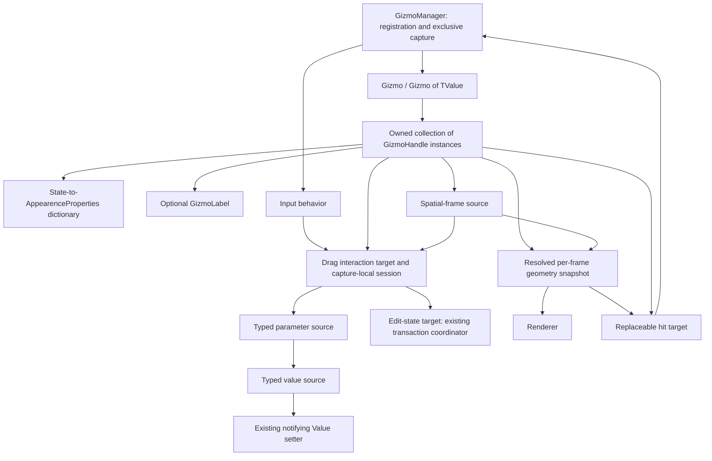
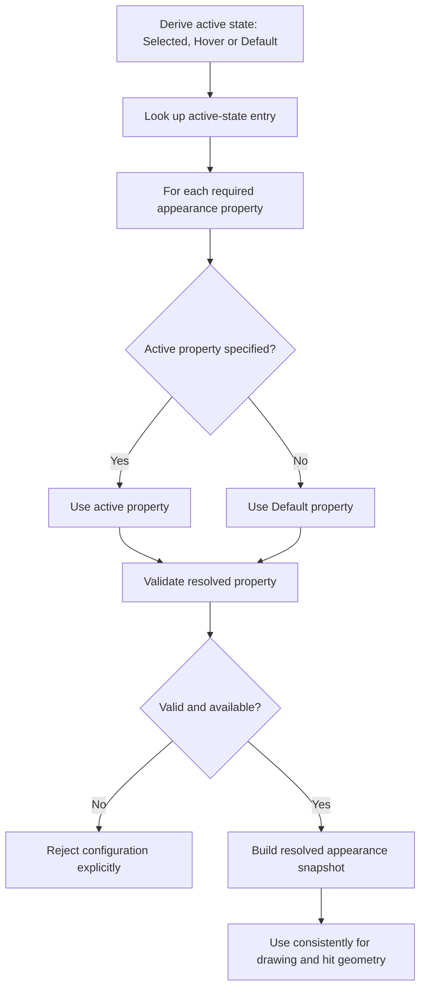
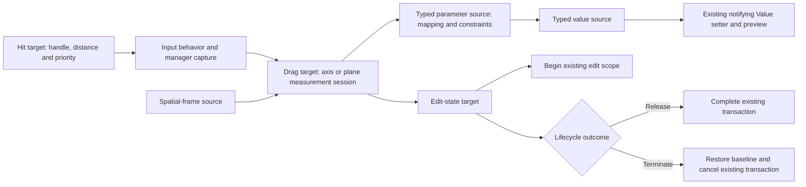

# Encapsulated gizmo handles and composable interactions

Status: Proposal. The nullable, state-based appearance model and composable interaction direction were approved on 2026-10-27. The architecture explicitly separates input behavior, hit targets, spatial sources, parameter interactions, parameter sources, value sources and edit-state targets. This document specifies their proposed integration; it does not claim implementation.

## Purpose and scope

Introduce a persistent `GizmoHandle` class representing an individual control attached to a gizmo. A handle owns its identity, appearance configuration, optional label, eligibility and interaction configuration. Per-frame geometry is a derived snapshot, not the handle itself.

Replace hardcoded handle-ID interpretation with composition:

- Shape determines what a handle looks like; a replaceable hit target provides picking, normally using the same resolved geometry.
- An input behavior manages the gesture lifecycle while an interaction target measures pointer movement.
- A spatial source supplies the axis or plane frame independently of rendered geometry.
- A typed parameter source interprets measured parameters and applies constraints through a value source.
- An edit-state target coordinates transactions. Existing manager, notifying value and transaction paths implement or are adapted to these boundaries rather than being duplicated.

This is a refactor of the existing positioning controls, not a request to ship new rotation, scaling or design-mode tools. Those are possible future consumers. Work-area persistence, HUD controls, resizing policy and wireframe rendering remain outside this change.

## Current implementation and motivation

The handle concept is currently distributed across:

- [Gizmo](../VanillaBuildingExpanded/src/Gizmos/Gizmo.cs): hovered/captured IDs, interaction lifecycle and a separate ID-keyed label map.
- [PositionGizmo](../VanillaBuildingExpanded/src/Gizmos/PositionGizmo.cs): fixed Center/X/Y/Z IDs, center-versus-axis dispatch and mutable drag state.
- [PositionGizmoGeometry](../VanillaBuildingExpanded/src/Gizmos/PositionGizmoGeometry.cs): generated shapes and transforms for those fixed parts.
- [GizmoRenderAdapter](../VanillaBuildingExpanded/src/Gizmos/GizmoRenderAdapter.cs): ID-dependent colors and hover/capture styling.
- [GizmoLabel](../VanillaBuildingExpanded/src/Gizmos/GizmoLabel.cs) and the [label renderer](../VanillaBuildingExpanded/src/Gizmos/GizmoRenderAdapter.Labels.cs): label configuration and cached overlay resources.
- [WorkAreaGizmoSession](../VanillaBuildingExpanded/src/BuildBrush/WorkAreaGizmoSession.cs): positioning values, work-area transactions, constraints and label content.

An ID currently carries implicit assumptions about shape, color and interaction. The refactor makes these explicit properties of persistent handles without moving work-area rules into reusable infrastructure.

## Ownership and component model



### Persistent handle

Each `GizmoHandle` contains:

- A stable `GizmoHandleId`, unique within its owner, for identity and deterministic hit ordering only.
- An owner reference; a handle belongs to at most one gizmo at a time.
- Local visibility and enabled flags.
- Its appearance-state dictionary and resolved active appearance.
- A spatial-frame source describing its logical frame relative to the gizmo.
- An optional `GizmoLabel`.
- A replaceable hit target and drag interaction target, configured with parameter, value and edit-state sources.

The owner exposes a read-only handle collection with controlled add/remove operations. Reject duplicate IDs, attaching the same instance twice and attaching a handle already owned by another gizmo. Detach before transferring ownership.

Hovered and captured handles reference actual owned handle instances. IDs may remain in events and diagnostic records for stable identification, but must no longer select shape, color or operation through numeric switches.

The manager remains the sole global input/capture coordinator. Handles do not register independent mouse handlers or renderers.

### Geometry snapshots

Replace the positioning-only generated-part assumption with immutable resolved geometry referencing its persistent handle. A snapshot contains the shape, spatial transform, resolved dimensions and other values needed by rendering and hit testing.

The default geometry-backed hit target and renderer consume the same camera/value/appearance snapshot. A custom hit target can provide deliberate pick padding or independent picking geometry without changing the interaction solver; its relationship to the visible handle must be explicit and tested. Shape, size or frame changes invalidate affected geometry; color-only changes do not require rebuilding spatial data. Preserve existing screen-sized controls, pick tolerances, overlay priority and distant-coordinate precision.

### Positioning compatibility baseline

Preserve these existing implementation details during the refactor:

- Arrow length is 64 GUI-scaled pixels converted to world units and clamped to `[0.125, 8]`; center radius is `7/64` of that reference length. Pick padding is 4 GUI-scaled pixels. Clipped parts are omitted from drawing and picking.
- Arrow-head bases are at `0.8125` of length with lateral extent `0.09375`. Circles use 16 segments; diamonds use 4. Center pick priority is 0, arrows 1.
- Local hit ordering is priority, distance, then stable ID. Cross-owner ordering retains the manager's `1e-6` distance bins and insertion order. Validate actual handle ownership again before consuming hits, including after callbacks.
- Axis start rejects perpendicular-ray squared magnitude `<= 1e-4`. Intersections reject absolute ray/normal dot `<= 0.01`, behind-ray values, nonfinite results or distances beyond `10000 * max(1, initial eye-anchor distance)`. Accepted-step limit is `max(64, 8 * initial distance)` from the last accepted unsnapped measurement.
- Colors are X `(1, 0.2, 0.2)`, Y `(0.2, 1, 0.2)`, Z `(0.25, 0.5, 1)` and center `(1, 0.85, 0.25)`. Normal/highlight opacity is `0.8/1`, line width `1.6/2.8`.
- Input uses current perspective context for previews and last drawn context for picking/release. Preserve handled-input/HUD/dialog checks and suppression of both native action families; invalidation cancels rather than commits.
- Renderer resources remain session-owned: shared line meshes, memory shaders, label textures and one quad. Opaque/AfterBlit callbacks retain order `0.49`, deferred membership/teardown outside native callback iteration, existing state guards and visible/logged failure handling.

## Appearance contract

Use the approved names exactly:

- `readonly record struct AppearenceProperties`
- `EAppearenceState`
- A handle-owned `Dictionary<EAppearenceState, AppearenceProperties>`
- `EAppearenceState.Default` as the required baseline.

Every property in `AppearenceProperties` is nullable so a state entry can specify only its overrides. Visual configuration belongs here rather than remaining scattered across renderer branches: shape, visual size, color, opacity, line width and configurable label styling. Content, visibility policy, interaction configuration and logical spatial frame are separate concerns.

The initial states are:

| State | Meaning |
|---|---|
| `Default` | Baseline appearance when not hovered or captured. |
| `Hover` | This eligible handle is hovered. |
| `Selected` | This handle is currently captured for interaction. |

`Selected` retains the project's existing meaning of held/captured, not persistent application selection. Capture takes precedence over hover. Hidden or ineligible handles are not made interactive by an appearance state.

Keep the mutable dictionary encapsulated. Expose a read-only view and validated configuration operations so mutations cannot bypass validation or invalidation. Retain the required `Default` entry throughout the handle's attached lifetime.

### Appearance fields and validation

Every field below is nullable in `AppearenceProperties`. `Default` supplies every shape-required field and all label fields when a label is attached. Validate every configured state before publishing a mutation, including states overriding the shape.

| Fields | Units and validation |
|---|---|
| Shape | A supported `GizmoShape`; no new catalog is introduced. |
| Size | Finite positive nominal logical-pixel extent: arrow 64, center radius 7. Convert using the clamped 64-pixel reference above to preserve sizing. |
| Color | Nullable `System.Numerics.Vector4` RGBA; every component must be finite and in `[0, 1]`. Override or inherit the whole color, including alpha; defaults as above. |
| LineWidth | Finite positive native framebuffer line width, default 1.6; hovered/selected override 2.8. |
| LabelTextColor | Nullable `System.Numerics.Vector4` RGBA, finite components in `[0, 1]`; default opaque white. |
| LabelBackgroundColor | Nullable `System.Numerics.Vector4` RGBA, finite components in `[0, 1]`; default black with alpha 0.65. |
| LabelFontFamily, LabelFontSize, LabelBold | Nonblank native font name, finite positive logical-pixel size and Boolean weight; defaults standard font, 14 and bold. |
| LabelPadding | Finite nonnegative logical pixels, default 3; text/padding follow GUI scale. |

Shape/size/frame changes invalidate spatial and pick snapshots and label anchors. Color/line-width changes affect drawing only. Label font/color/background/padding changes invalidate raster content; text/offset/visibility remain `GizmoLabel` configuration. Offset/visibility changes neither rerasterize nor cancel. Color vectors are atomic appearance properties; individual RGBA components do not have separate fallback.

### Per-property fallback

Resolve each property independently:

```text
resolved.Property = activeOverride.Property ?? defaultEntry.Property
```

A missing active-state entry is equivalent to an all-null override. Do not inherit unspecified `Selected` properties from `Hover`; every non-default state falls back directly to `Default`.

The baseline must supply valid values for every property required by its configured shape and attached label. Reject incomplete or invalid configurations explicitly before publishing the change. Do not invent silent renderer fallback values. A resolved snapshot contains validated, usable values rather than requiring every draw call to repeat nullable resolution.



For example:

| Property | Default | Hover override | Resolved Hover |
|---|---|---|---|
| Color (RGBA) | `(1, 0.2, 0.2, 0.8)` | `(1, 0.2, 0.2, 1)` | `(1, 0.2, 0.2, 1)` |
| Line width | 1.6 | 2.8 | 2.8 |
| Shape | Arrow | null | Arrow |

Initial handle configurations preserve existing visuals: red/green/blue arrows, circle/diamond center markers, normal opacity 0.8, highlighted opacity 1.0, and line widths 1.6/2.8.

## Composable interaction contract

Do not introduce a closed `InteractionRole` enum for translation, scaling, rotation or application operations. These are compositions, not intrinsic handle identities.

### Required architectural boundaries

Preserve all seven boundaries below. The names are proposed project contracts, not an instruction to merge these responsibilities into one behavior class. Existing implementations may satisfy multiple contracts where appropriate, but consumers depend only on the contract they need.

| Responsibility | Proposed abstraction | Boundary |
|---|---|---|
| Input capture and press/drag/release lifecycle | `GizmoDragInputBehavior` targeting `IGizmoDragTarget` | Processes gestures through the existing input adapter and manager; does not implement movement math or application edits. |
| Identify the hit visual element | `IGizmoHitTarget` | Returns the owned handle, ray distance and priority; receives hover/interacting state updates without choosing an operation. |
| Supply an axis or plane coordinate frame | `IGizmoFrameSource` | Supplies origin, direction and plane basis from logical state, independently of mesh data. |
| Convert pointer movement into parameters | Axis/plane interaction targets implementing `IGizmoDragTarget` | Own capture-local measurement sessions; consume spatial frames and publish typed parameters. |
| Interpret and apply parameters | `IInteractionParameterSource<TParameter>` | Exposes current parameters and begin/set/end-modification operations; maps edits through constraints to a typed value source. |
| Read/write the edited value | `IGizmoValueSource<TValue>` | Provides typed access to the existing notifying `Gizmo<TValue>.Value`; contains no pointer math or transaction policy. |
| Coordinate edit transactions | `IGizmoEditStateTarget` | Begins, completes or cancels an edit through existing baseline restoration and application transaction paths. |

These are real replaceable interface boundaries, not only headings for private methods in one monolithic interaction. Typed adapters and delegate-backed implementations can keep simple configurations lightweight without weakening separation.

### Input behavior and hit targets

The manager remains responsible for global routing, hit arbitration and exclusive capture. The drag input behavior implements the gesture state machine through that manager and calls the selected target's eligibility, press, drag, release and termination hooks. It does not create another global input subscription or independently claim capture.

A hit target normally wraps resolved handle geometry. It can also wrap a hierarchy or aggregate and return any owned handle identity; generic dispatch does not require predefined part IDs. Eligibility can disable hitting without changing the visible shape. Hover and interacting updates feed the handle's existing state/appearance path rather than introducing a second state store.

The interaction target is independent of the hit target. The same axis solver can be connected to an arrow, another shape or custom picking geometry.

### Spatial-frame sources and measurement targets

A frame source supplies a validated origin, axis direction and, where needed, orthogonal plane tangents in the current dimension. Both visual geometry and measurement can consume the source; measurement never reconstructs its axis from vertices or shape IDs.

Sources may derive frames from a position, an owner transform or the camera. Measurement sessions freeze the drag-start frame where required by existing behavior, including the camera-facing center plane. Subsequent camera movement does not silently rebase a captured drag.

Axis and plane interaction targets convert pointer rays into scalar or two-dimensional parameters. A successful begin creates a session containing initial intersections, grab offsets, last accepted measurements and other capture-local solver data. Do not store shared mutable drag state on reusable definitions. An angle interaction is a future implementation of this same boundary, not a new central role.

### Parameter sources and typed value sources

Parameter sources expose read, begin-modification, set and end-modification operations for their parameter type. Begin-modification records the initial parameter/value relationship. Set maps measured changes to a candidate, applies constraints and reports acceptance or rejection explicitly. End-modification releases parameter-edit bookkeeping; it does not commit an application transaction.

Use scalar and two-dimensional parameter types for the current solvers, while allowing other typed parameter sources. Translation, scaling and other interpretations are adapters at this layer. For example, an axis solver can publish the same scalar distance to either a position adapter or a dimension adapter.

Adapters read/write an `IGizmoValueSource<TValue>`. The default value source delegates to the existing notifying `Gizmo<TValue>.Value` setter. It does not maintain another authoritative copy, provide silent assignment or assume every edited value is a transform. Existing position constraints and snapping callbacks remain reusable within parameter adapters.

Typed implementations retain their parameter and value types behind the non-generic input lifecycle. A non-generic handle does not require boxed values, runtime casts or an untyped replacement for `Gizmo<TValue>`.

### Edit-state targets

The interaction lifecycle invokes an edit-state target once for each accepted edit. That target adapts existing gizmo baseline handling and the owner's preview/commit/cancel transaction integration. It does not add another undo stack, persistence owner or independent rollback store.

An eligible press first validates and initializes measurement. For an accepted begin, initialize parameter modification and the edit-state scope before publishing the successful interaction-start notification. Failed initialization unwinds any initialized scopes without leaving capture or emitting successful completion. Initialization failures use existing error reporting rather than disappearing silently.

During dragging, parameter sources update the value source and existing owner preview path. Normal release ends parameter modification and completes the edit-state scope once. Cancellation ends parameter bookkeeping, restores the baseline through the notifying value source and cancels the existing owner transaction before the cancellation notification. Parameter end-modification is not itself a commit; forced termination must route to cancellation, not successful completion.

Existing lifecycle code may continue performing baseline restoration internally. The edit-state adapter coordinates that same path rather than restoring twice or separately invoking owner handlers already reached by lifecycle notifications.

The prepared session begins parameter bookkeeping before the edit-state scope. A parameter initializer that throws unwinds its partial bookkeeping. An edit initializer that rejects or throws unwinds its own partial owner scope; the session then ends initialized parameter bookkeeping and releases capture-local resources. No successful-start, completion or commit follows failed initialization.

Clear active session/capture references before terminal callbacks and reject begins during initialization or termination. Repeated terminal calls are no-ops; disposal cancels unfinished work. Release capture-local resources exactly once even when callbacks fail, and propagate failures to the existing logging/notice path. If parameter cleanup fails during release, cancel the owner scope instead of committing it. Surface owner-commit failures without a successful completion notification or an invented rollback of already committed state; preserve dirty-save/retry semantics.

The input behavior owns its accepted session. Sessions borrow frame, parameter, value and edit-state configuration, whose lifetime belongs to the gizmo/session composition; sessions do not dispose shared sources. The manager retains global membership/capture, `Gizmo` retains its interaction baseline, `WorkAreaController` retains the endpoint-pair baseline, and `WorkAreaGizmoSession` retains synchronization and preview/commit/cancel binding. Adapt these same paths and remove superseded wiring at cutover.



### Examples of composition

| Geometry | Measurement behavior | Binding | Result |
|---|---|---|---|
| Arrow | Axis distance | Position binding | Axis-constrained translation |
| Same arrow | Same axis distance | Dimension/scale binding | Resize or scale |
| Circle or diamond | Camera-plane delta | Position binding | Free planar translation |
| Future ring | Angle around an axis | Rotation binding | Rotation |
| Custom shape | Custom behavior | Custom typed binding | Application-specific control |

These are illustrative combinations, not a mandatory catalog or new implementation scope. Shape never implicitly selects an operation.

For this refactor, implement the seven boundaries with the existing analytic axis and camera-facing-plane interactions, position parameter adapters, notifying value-source adapter and existing transaction adapter. Preserve grab offsets, drag-start frames, degeneracy checks, excessive-jump protection and constraint rejection behavior. No terrain-dependent drag fallback is introduced.

## Capture, cancellation and mutation

- At most one handle is captured globally, through the existing manager.
- A rejected begin leaves no captured handle, active session or successful-start notification.
- Completion keeps the accepted final value and uses the existing completion/commit path once.
- Cancellation restores the drag-start value through the notifying setter before the cancellation notification, preserving existing rollback ordering.
- Removing, hiding or disabling a captured handle cancels before detaching or invalidating it. Apply the same rule when its owner becomes ineligible, changes dimension, is removed or is disposed.
- Replacing a captured handle's interaction target, hit target, frame source, parameter source, value source or edit-state target first cancels the existing session. The replacement cannot reinterpret an in-progress drag.
- Ordinary hover/capture appearance transitions do not cancel. Appearance changes rebuild affected render/hit data without resetting captured solver baselines.
- Label text, offset and visibility-policy changes do not cancel capture or alter hit targets.
- Before applying a genuinely different external authoritative value during capture, retain the existing cancel-then-assign ordering.
- Dispose capture-local resources and release callbacks exactly once on completion, cancellation or failed initialization. Gizmo disposal also clears owned handles and their subscriptions.

The interface boundaries supplement existing transaction ownership; they must not create another undo stack, authoritative value store or independently committing cancellation path.

## Labels and rendering

Move optional label ownership from the gizmo's separate ID-keyed map onto `GizmoHandle`. Preserve the existing label contract:

- `Always`, `Hover`, `Selected` and custom `Predicate` visibility modes.
- Hover and captured/selected remain distinct states.
- Visibility predicates evaluate live state only after owner/handle eligibility checks.
- Offsets remain framebuffer pixels from the projected anchor, positive right/down, positioning the label's top-left corner.
- Axis labels anchor at arrow tips; center labels anchor at handle origins.
- Existing white text, padding and black background at 65% opacity remain the defaults.
- Endpoint center labels remain localized Center; the whole-area midpoint's center label remains the selected work area's name and updates on rename.

The renderer reads resolved handle appearance instead of numeric IDs. It retains responsibility for shaders, GPU state restoration, texture caching and resource disposal. Handles contain configuration, not native textures or shader instances.

Key label caches by persistent handle identity within the owner. Refresh only resources affected by text, scale or styling changes; prune detached/disposed handles and removed labels. A state-dependent geometry change also updates the projected label anchor.

## Migration and compatibility

1. Define the seven contracts, including lifecycle ordering, rejection reporting and ownership of capture-local resources. Adapt existing manager, value and transaction paths without duplicating them.
2. Introduce the handle class, validated appearance configuration, ownership operations and resolved snapshots. Add geometry-backed hit targets and position/camera spatial-frame sources.
3. Extract existing axis/plane math into measurement targets with capture-local sessions. Implement typed position parameter adapters consuming the notifying value source and edit-state adapter.
4. Construct the existing Center/X/Y/Z controls by explicitly composing these contracts, reproducing current visuals and constraints.
5. Move labels onto handles and update session naming/localization and renderer cache ownership.
6. Route rendering, picking, hover and capture through handle instances. Remove numeric-ID styling/operation switches, the obsolete label map and superseded solver state.
7. Preserve work-area endpoint and midpoint transaction wiring; verify one begin/complete/cancel path and remove superseded duplicate helpers.

Existing ID constants may remain convenient named identifiers, but must not be required for generic renderer or interaction behavior. Update in-repository callers together; no persisted data format changes or legacy configuration migration are needed.

This proposal supersedes the earlier component-level handle assumptions in the [historical InWorldGizmos.proposal.md](https://github.com/dsisco11/VanillaBuildingExtended/blob/04172078d76652ec9fc5610351b926c66daf0399/docs/InWorldGizmos.proposal.md), not its established input, precision or cancellation requirements. That completed document was retired from the worktree; the linked immutable revision remains available locally with `git show 04172078d76652ec9fc5610351b926c66daf0399:docs/InWorldGizmos.proposal.md`. [BuildBrushArchitecture.md](BuildBrushArchitecture.md) should be updated when implementation changes, rather than describing this proposal as already shipped.

All new or changed public contracts and non-obvious lifecycle details require Doxygen-compatible XML documentation, including parameters, return values and validation exceptions.

## Verification and acceptance criteria

Implementation is complete only when:

- Ownership tests cover duplicate IDs, double attachment, transfer, detachment and disposal.
- Appearance tests cover every nullable field's independent fallback, absent overrides, complete-baseline validation, invalid values, state precedence and configuration changes while hovered/captured.
- Default draw/hit tests verify the same resolved shape, transform and dimensions, including state-dependent shape/size changes and unchanged minimum pick tolerances. Custom hit-target tests verify deliberate pick geometry and unchanged measurement behavior.
- Identity tests demonstrate that arbitrary IDs do not change visuals or interaction semantics.
- Contract tests exercise all seven boundaries independently: gesture routing without movement math, arbitrary-handle hit targets, spatial sources without meshes, measurement without application values, parameter adapters without pointer input, notifying value access and transaction coordination.
- Composition tests demonstrate the same measurement target with different typed parameter adapters, replacement hit targets and spatial sources, without adding an operation enum or modifying central dispatch.
- Transaction tests prove parameter end-modification cannot commit independently, forced termination cancels, rejected initialization unwinds scopes, and baseline restoration and owner transaction notifications are not duplicated.
- Lifecycle tests cover rejected begin, capture exclusivity, completion, rollback ordering, reentrant callbacks, configuration changes and exactly-once cleanup.
- Existing analytic positioning and work-area tests retain axis constraints, camera-plane movement, snapping, large-coordinate precision, dimension checks and no per-preview persistence writes.
- Label tests cover eligibility, all four visibility modes, offsets, rename/localization updates, styling changes and resource pruning.
- Relevant tests, the normal build and JSON validation pass without unrelated changes.
- In-game checks confirm visual parity, overlapping-handle selection, cursor/reticle capture, cancellation and label placement. Unit tests alone do not qualify actual rendering.

No existing task is marked complete by creation of this document. Rotation/scaling tools, new shape catalogs, wireframe occlusion fixes and other design-mode features remain separate work.
